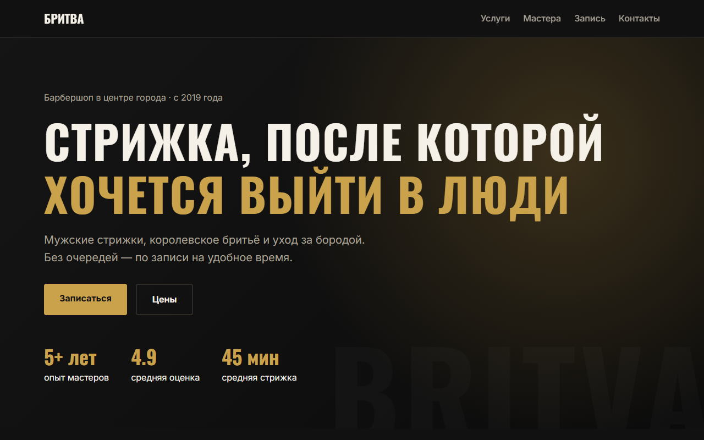

# Примеры лендингов

Пять учебных одностраничных сайтов на чистом HTML, CSS и JavaScript без фреймворков.
Все заведения, имена и отзывы вымышленные — сайты сделаны для портфолио.

| Сайт | Что показывает |
|---|---|
| [Барбершоп «Бритва»](barbershop/) | тёмная тема, прайс, мастера, форма записи |
| [Кофейня «Зерно»](coffee/) | меню с вкладками, заказ навынос |
| [Репетитор английского](tutor/) | программы, этапы обучения, отзывы, пробный урок |
| [Персональный тренер](fitness/) | тарифы, калькулятор стоимости курса |
| [Цветочная мастерская «Пион»](flowers/) | каталог букетов, оформление доставки |



## Что есть в каждом сайте

- адаптивная вёрстка: телефон, планшет, компьютер;
- мобильное меню;
- форма заявки с проверкой полей (в демо заявка никуда не отправляется);
- заголовки, описание и превью для соцсетей (meta, Open Graph);
- никаких внешних картинок: иллюстрации нарисованы на CSS.

## Структура

```
shared/base.css    общая основа вёрстки
shared/form.js     форма заявки и мобильное меню
<сайт>/index.html  страница с собственными цветами и шрифтами
screenshots/       скриншоты для портфолио
```

## Запуск

Откройте `index.html` в браузере — сборка не нужна.
